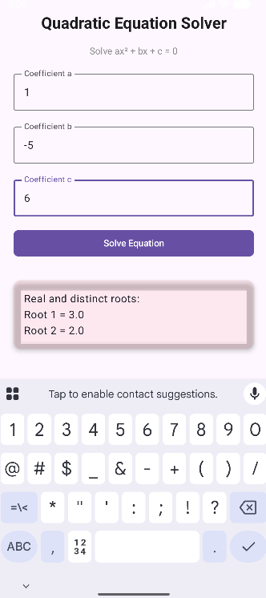

# Quadratic Equation Solver

A clean, minimal Android app built with **Jetpack Compose** that solves quadratic equations of the form **ax² + bx + c = 0**

  

## Requirements

- **Android Studio** (Hedgehog or newer recommended)
- **Android SDK** 24+ (Android 7.0 Nougat or higher)
- **Kotlin** 1.9+
- **Jetpack Compose** BOM (as set up by Android Studio's "Empty Compose Activity" template)

## Installation / Build

1. **Clone the repo:**
   ```bash
   git clone https://github.com/einye/compose-quadratic-app.git